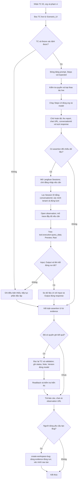

# Flow thực thi Workspace UI & Func

Cập nhật theo yêu cầu 05/11/2026: chỉ so dữ liệu UI trả về với Input/Output log; không kiểm Input giống prompt. Đối chiếu dữ liệu và phạm vi UI công bố với Input/Output của `tool.execution:query_data`. Thay thế bước gọi QE API Postman trong flow Workspace.

## Ranh giới và dependency

- Đọc [information security](../../../../03-knowledge/governance/information-security-policy.md) trước dữ liệu/auth/evidence; [live testing](../../../../03-knowledge/qa-intelligence/standards/live-environment-testing-standard.md) trước thao tác live.
- Read-only reporting và xem/filter log không tự yêu cầu backup. Tạo/sửa/xóa business entity hoặc saved app/view/report áp dụng gate live tương ứng; không sửa prompt nguyên văn để lách gate.
- Kế thừa authorization trong chat; không xin lại chỉ vì đổi skill. Việc cập nhật bộ skill không tự cấp quyền chạy TC mới, ghi Sheet hoặc tạo Bug.
- Nguồn đối chiếu là log của đúng response. Không dùng flow QE sibling, signIn/chooseOrg/productList/variantList hoặc mapping QE để thay thế log. Evidence QE cũ giữ nguyên lịch sử và không được gắn lại thành evidence Langfuse.
- Không tự sửa Expected trên workbook khi TC cũ còn nhắc QE: giữ snapshot nguyên văn, ghi override nguồn đối chiếu theo yêu cầu hiện tại và báo khác biệt. Các assertion nghiệp vụ còn lại giữ nguyên.

## Trình tự và đầu ra

| Bước | Skill | Đầu ra |
|---|---|---|
| Intake | read-workspace-testcase | Snapshot, assertions, fixture, scope yêu cầu |
| UI | run-workspace-ui-testcase | Response hoàn tất, chat URL, conversationId, turn, rows/columns và scope thực tế |
| Log + compare | compare-workspace-report-log | Session/trace/observation provenance, Phạm vi UI ↔ Input/Output, values/diff, coverage |
| Record | record-workspace-test-result | Token hợp lệ, Note ngắn và Version đúng model đã readback |
| Bug, khi được yêu cầu | create-workspace-bug | Draft hoặc ID/link DevTak đã xác minh |
| Điều phối | execute-workspace-ui-func | Báo cáo cuối và phần chưa xác minh |

UI → log → compare cho từng TC trước khi chuyển TC khác. Xem [Langfuse runtime](langfuse-log-runtime.md) để chọn đúng turn/query và đọc đầy đủ Raw. Không chạy lại UI/API để lấp log thiếu hoặc ép kết quả khớp.

## Verify Bug theo ticket

Khi người dùng cung cấp ticket để verify và cập nhật kết quả, dùng [verify-workspace-bug](../skill/verify-workspace-bug/SKILL.md): đọc ticket → tìm TC liên quan trong Scenario_UI → chạy mới từng TC theo flow trên → ghi status/Note/Version → comment Activity PASS/FAIL theo mẫu, có thời gian, conversion link và ảnh; chỉ FAIL có Reason thuộc lỗi ticket. Giữ riêng kết luận lỗi ticket và status toàn TC; lỗi ngoài ticket vẫn ghi Sheet. Chuyển ticket sang `In testing` khi bắt đầu verify và đọc lại sau cập nhật; không tạo Bug khác.

## Đổi hướng trong chat

- “Đọc lại/run lại”: đọc TC live và tạo run mới, không dùng prompt/row/kết quả cũ.
- “Chỉ sửa Note”: dùng evidence của đúng run đã có, ghi một ô, giữ status/Version và nguồn lịch sử; không mở run mới.
- “Stop”: ngừng action mới, gửi prompt và writeback ngay.
- TC đổi giữa run: giữ provenance cũ, chặn writeback không còn cùng snapshot; báo khác biệt trước run mới.

## Kết luận và ghi kết quả

Áp dụng [comparison contract](comparison-contract.md): FAILED khi có sai lệch đã chứng minh; PASSED khi đủ mọi assertion bắt buộc; BLOCK khi chưa có fail nhưng còn thiếu evidence. Log thành công không tự chứng minh UI khớp dữ liệu. Compare chỉ kết luận UI ↔ Input/Output; không kiểm Input ↔ prompt/Expected và không dùng khác biệt đó để FAILED/BLOCK. Metric trực tiếp khớp Output không bị block vì thiếu công thức nội bộ backend.

Chỉ ghi Sheet khi đã được yêu cầu; đọc lại TC/header/validation, ghi status/Note/Version đúng model cùng batch và readback. Version là thời điểm hoàn tất thực thi trong run record theo giờ Việt Nam; sửa Note không đổi mốc. Note theo [template](../assets/test-result-template.md), chỉ sai lệch; full comparison giữ trong run record tối thiểu.

Phản hồi cuối nêu kết quả, Input/Output lệch quan trọng, phạm vi log/rows đã kiểm, phần bị chặn, chat/observation URL và cells đã ghi. Bug chỉ tạo theo yêu cầu, dùng evidence đúng run; không rerun để viết ticket hoặc tự ghi link Bug vào Sheet.
