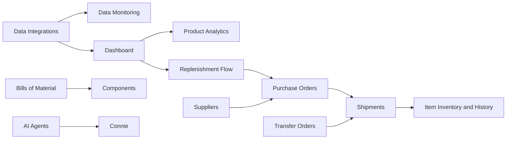

# Conative Capability Map

## Product Areas

| Product area | Documented capabilities | QA relevance |
|---|---|---|
| Dashboard | Inventory priorities, sales performance, product results, stock conditions, and next actions | Entry point into analysis and replenishment workflows |
| Product Analytics | Product Performance plus product, category, collection, and monthly sales views | Metric, filter, grain, and channel validation |
| Inventory Buying | Replenishment Flow by product or variant | Forecast range, reorder quantity, Target Coverage Days, export, and PO initiation |
| Inventory Control | Purchase orders, transfer orders, shipments, items, components, warehouses, suppliers, and bills of material | Transaction state, inventory movement, master data, import, and cross-record validation |
| Data Management | Data Integrations and Data Monitoring | Source configuration, sync health, status, and freshness validation |
| AI Assistance | AI Agents and Connie | Prompt/action selection, generated responses, schedules, history, and recovery behavior |

## Cross-Capability Relationships

The source documents establish these as visible navigation or workflow
relationships. They do not fully establish calculation rules, data lineage,
automatic state transitions, or downstream inventory effects.

## Current Documentation Coverage

| Document type | Count |
|---|---:|
| Product overview | 1 |
| Product-area overview | 3 |
| Feature | 15 |
| Workflow | 19 |
| Reference | 1 |
| Total | 39 |

No canonical troubleshooting document was present during this ingest.
